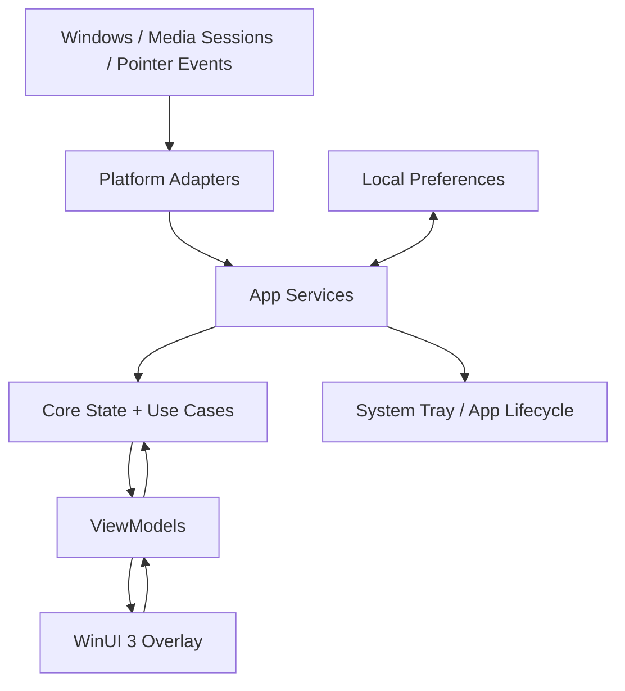

# Architecture and Component Boundaries

## 1. Architecture principle

This is a local desktop application, **not a client-server product**. “Backend” in this project means local services and OS integration inside the app process; there is no web API or remote database in the MVP.

## 2. Projects and responsibilities

### `DynamicTopBar.App`

Host and presentation layer:
- App startup and lifetime coordination.
- WinUI windows, views, resources, and view models.
- Overlay positioning, z-order, non-activation and hit testing.
- System tray integration and settings surface.
- Concrete service registration and platform adapters.

Keep WinUI types and native Windows APIs out of the Core project.

### `DynamicTopBar.Core`

Platform-independent rules:
- `OverlayState`: Idle, HoverPending, Expanded, CollapsePending.
- Neutral media model: title, artist, artwork reference, playback state, position/duration when available, supported actions.
- Transition rules and use cases.
- Interfaces/abstractions consumed by the app layer.

Core should be unit-testable without opening a real Windows window.

### `DynamicTopBar.Tests`

Automated tests for state transitions, timing decisions (using controllable abstractions where feasible), and mapping/fallback rules. UI automation is a later optional addition.

## 3. Dependency direction

Allowed: `App → Core`.

Disallowed: `Core → App`, `Core → WinUI`, and `Core → concrete Win32/WinRT classes`.

Platform-specific adapters implement interfaces and convert OS-specific values into neutral Core models. Do not add a separate process/service unless a concrete technical requirement proves it necessary.

## 4. Proposed service boundaries

- `IMediaSessionService`: exposes current media snapshot and change notifications; concrete Windows API implementation is researched in Phase 3.
- `IOverlayWindowService`: show, hide, resize, reposition, and window interaction configuration.
- `IUserPreferencesService`: reads/writes small local preferences.
- `IAppLifecycleService`: coordinates single-instance launch, shutdown, and tray actions.
- `IClock` / timer abstraction: optional, if it makes state-transition tests deterministic.

Names are provisional. Introduce only interfaces that provide a real boundary; avoid abstraction for every class by default.

## 5. Runtime data flow

1. Windows pointer/media event is received by an adapter.
2. Adapter converts it to a neutral event or model.
3. Core transition logic updates the overlay state or current media snapshot.
4. ViewModel exposes presentation state.
5. WinUI updates compact or expanded content.
6. User action flows back through a ViewModel/use case to the relevant service.

## 6. Failure handling

- No media session: show a neutral idle/empty state; do not invent metadata.
- Missing artwork: show a local bundled fallback icon.
- Unsupported media action: disable or omit the control rather than pretending it works.
- Media session disappears: unsubscribe safely and refresh the snapshot.
- Display geometry changes: recompute placement without crashing or leaving the overlay off-screen.
- Settings unavailable/corrupt: use defaults and preserve app startup where possible.

## 7. Technical proof of concept before commitment

Before building the full media widget, validate that the chosen Windows Media API can be called from the selected WinUI 3/.NET template and can surface session metadata and supported controls. Record API limitations and target OS assumptions. Keep this proof isolated; do not let unverified interop dictate the rest of the architecture.
