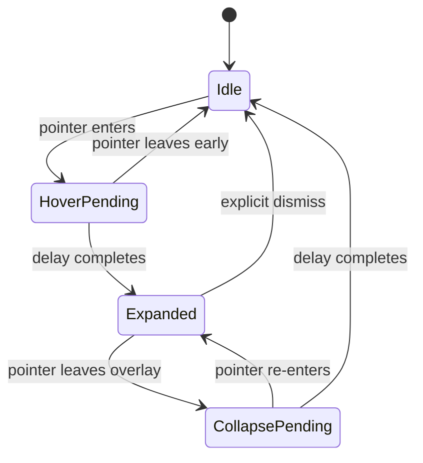

# UX Specification — Adaptive Top Bar

## 1. Visual states

### Idle
- Slim capsule centered near the top edge of the chosen display.
- Starting target height: 44 effective UI units.
- Dark neutral surface; modest transparency only if text and icons stay legible.
- Small app/activity indicator plus a carefully limited set of status glyphs.
- No large text, widget cards, gradients, or persistent expanded content.

### Hover pending
- Keep the idle appearance while the pointer remains over the bar for the hover delay.
- Default delay: 500 ms.
- If the pointer leaves before the delay completes, cancel expansion.

### Expanded
- Expand downward from the same capsule; preserve the visual identity of the header.
- Show current media metadata and playback controls only when meaningful.
- Album artwork: square with rounded corners and a fallback image.
- Song title is primary; artist is secondary; truncate long text rather than stretching the bar indefinitely.
- Progress display is shown only when duration/position are available and meaningful.
- Use spacing and typography consistently; avoid redundant labels and too many icons.

### Collapse pending
- When the pointer leaves the whole interactive overlay, begin the collapse delay (default: 4 seconds).
- Re-entry cancels collapse immediately.
- Active user interaction must not be interrupted by the timeout.
- Click outside behavior should be defined and tested; do not make dismissal feel random.

## 2. State diagram

## 3. Interaction rules

- Hover must not take keyboard focus by itself.
- Clicking a control may activate interaction, but do not unexpectedly activate or foreground another application.
- Media buttons reflect capability and current state (play vs pause).
- Avoid tooltips that appear immediately; use a small delay if tooltips are added.
- If reduced-motion is enabled or motion causes visual discomfort, prefer a short fade/size transition rather than bouncy motion.
- Make every icon button's accessible name explicit.
- Ensure interactive parts can be reached with keyboard navigation when the panel is intentionally focused.

## 4. Layout and design tokens (initial)

These are starting tokens for implementation and should be adjusted after the first real build:

| Token | Phase 4 Value | Use |
|---|---:|---|
| `Color.Background` | `#090909` | Main overlay surface |
| `Color.Surface` | `#171717` | Secondary surface / chips |
| `Color.Border` | `#2A2A2A` | Subtle outline |
| `Color.TextPrimary` | `#F5F5F5` | Main text / title |
| `Color.TextSecondary` | `#A7A7A7` | Secondary metadata / artists |
| `Color.Accent` | `#00B4FF` | Active progress accent, sparingly |
| `Bar.IdleHeight` | `44` | Idle height in effective UI units |
| `Bar.IdleWidth` | `340` | Idle width accommodating app chip and system status |
| `Bar.ExpandedHeight` | `188` | Expanded panel height |
| `Bar.ExpandedWidth` | `370` | Expanded panel width |
| `Bar.CornerRadius` | `22` | Pill radius |
| `Bar.AlbumArtCornerRadius` | `10` | Album artwork corner radius |
| `Bar.ChipCornerRadius` | `12` | Header app chip corner radius |
| `Panel.Padding` | `16` | Inner panel horizontal padding |
| `Motion.HoverDelayMs` | `500` | Hover expansion delay |
| `Motion.CollapseDelayMs` | `4000` | Collapse delay |
| `Motion.ExpandDurationMs` | `220` | Downward slide-fade animation duration |
| `Motion.CollapseDurationMs` | `180` | Collapse fade-out animation duration |

Typography baseline: Segoe UI / Segoe UI Variable. Song title 15px semibold, artist 12px regular, status and timestamps 10-11px. All tokens centralized in `App.xaml` resources.

## 5. Positioning and displays

- Start with the primary display, centered horizontally, at a small safe inset from the top.
- Ensure the component does not cover important system-owned UI or leave a large invisible hit-test region.
- When multiple displays are introduced, store or derive the selected display policy explicitly.
- Recompute position on display geometry or DPI changes.
- Keep exact fullscreen behavior as a tested product decision, not a guarantee.

## 6. Empty and error states

- No media session: compact bar remains valid; expanded panel can show a subtle empty state only if invoked.
- Missing song/artist/artwork: omit unavailable fields and show fallback artwork.
- Unsupported control: hide or disable it with a clear accessible state.
- Loading: use a brief, subtle placeholder; avoid indefinite skeleton animation.
