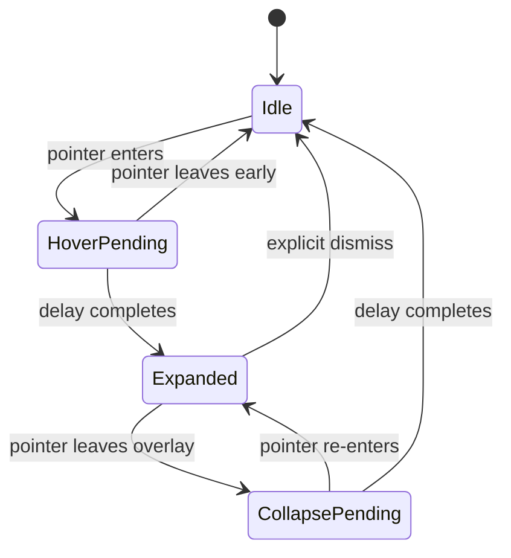

# UX Specification — Adaptive Top Bar

## 0. Multi-feature panel and navigation

The expanded panel is a **feature carousel**, not a music-only surface. The initial enabled modules are Media and Focus Timer; Quick Launch and System Glance are subsequent MVP modules. See `FEATURE_CATALOG.md` and `FEATURE_DEVELOPMENT_PLAN.md` for the catalog and delivery order.

- Place `Previous feature` and `Next feature` icon buttons in the expanded panel, near the content/footer where they remain easy to reach without competing with the primary action.
- Show the current feature icon/name and a restrained page indicator (`2 / 4` or small dots).
- Each arrow changes the selected feature content inside the same panel; do not open another window.
- Default to no wrap-around: Previous is disabled on the first page, Next is disabled on the last page. Hide both arrows if only one feature is enabled.
- Support Left/Right arrows only when the expanded panel or one of its controls intentionally owns keyboard focus; never intercept those keys globally.
- Optional pointer swipe/trackpad navigation is a later enhancement, not a prerequisite for the MVP.
- Animate a short horizontal slide/fade, but keep text readable and support reduced motion.
- The pointer hit-test region must include the navigation controls and the full content area to prevent accidental collapse while moving between them.
- Navigating must not reset module state; for example, moving away from Focus Timer must not reset or duplicate its countdown.
- Do not automatically force-switch the selected page when new media/notifications arrive. Show a small activity indicator instead unless the user explicitly enables context-switching later.
- Navigation applies to enabled and available modules only. Never show a module as working until its required adapter/API is implemented.

## 1. Visual states

### Idle
- Slim capsule centered near the top edge of the chosen display.
- Starting target height: 44 effective UI units.
- Dark neutral surface; modest transparency only if text and icons stay legible.
- Small app/activity indicator plus a carefully limited set of status glyphs.
- No large text, widget cards, gradients, or persistent expanded content.

### Hover pending
- Keep the idle appearance while the pointer remains over the bar for the hover delay.
- Default delay: 500 ms.
- If the pointer leaves before the delay completes, cancel expansion.

### Expanded
- Expand downward from the same capsule; preserve the visual identity of the header.
- Show current media metadata and playback controls only when meaningful.
- Album artwork: square with rounded corners and a fallback image.
- Song title is primary; artist is secondary; truncate long text rather than stretching the bar indefinitely.
- Progress display is shown only when duration/position are available and meaningful.
- Use spacing and typography consistently; avoid redundant labels and too many icons.

### Collapse pending
- When the pointer leaves the whole interactive overlay, begin the collapse delay (default: 4 seconds).
- Re-entry cancels collapse immediately.
- Active user interaction must not be interrupted by the timeout.
- Click outside behavior should be defined and tested; do not make dismissal feel random.

## 2. State diagram

## 3. Interaction rules

- Hover must not take keyboard focus by itself.
- Clicking a control may activate interaction, but do not unexpectedly activate or foreground another application.
- Media buttons reflect capability and current state (play vs pause).
- Avoid tooltips that appear immediately; use a small delay if tooltips are added.
- If reduced-motion is enabled or motion causes visual discomfort, prefer a short fade/size transition rather than bouncy motion.
- Make every icon button's accessible name explicit.
- Ensure interactive parts can be reached with keyboard navigation when the panel is intentionally focused.

## 4. Layout and design tokens (initial)

These are starting tokens for implementation and should be adjusted after the first real build:

| Token | Initial value | Use |
|---|---:|---|
| `Color.Background` | `#090909` | Main overlay surface |
| `Color.Surface` | `#171717` | Secondary surface |
| `Color.Border` | `#2A2A2A` | Subtle outline |
| `Color.TextPrimary` | `#F5F5F5` | Main text |
| `Color.TextSecondary` | `#A7A7A7` | Secondary metadata |
| `Color.Accent` | `#00B4FF` | Active/progress accent, sparingly |
| `Bar.Height` | `44` | Idle height in effective UI units |
| `Bar.CornerRadius` | `22` | Pill radius |
| `Panel.Padding` | `16` | Inner padding |
| `Motion.HoverDelayMs` | `500` | Hover expansion delay |
| `Motion.CollapseDelayMs` | `4000` | Collapse delay |

Typography baseline: Segoe UI / Windows system typography. Use a restrained scale; song title around 14–16 effective units semibold, artist and helper text around 12–13 units. Do not hard-code all dimensions inline in XAML; centralize reusable resources once UI work begins.

## 5. Positioning and displays

- Start with the primary display, centered horizontally, at a small safe inset from the top.
- Ensure the component does not cover important system-owned UI or leave a large invisible hit-test region.
- When multiple displays are introduced, store or derive the selected display policy explicitly.
- Recompute position on display geometry or DPI changes.
- Keep exact fullscreen behavior as a tested product decision, not a guarantee.

## 6. Empty and error states

- No media session: compact bar remains valid; expanded panel can show a subtle empty state only if invoked.
- Missing song/artist/artwork: omit unavailable fields and show fallback artwork.
- Unsupported control: hide or disable it with a clear accessible state.
- Loading: use a brief, subtle placeholder; avoid indefinite skeleton animation.
