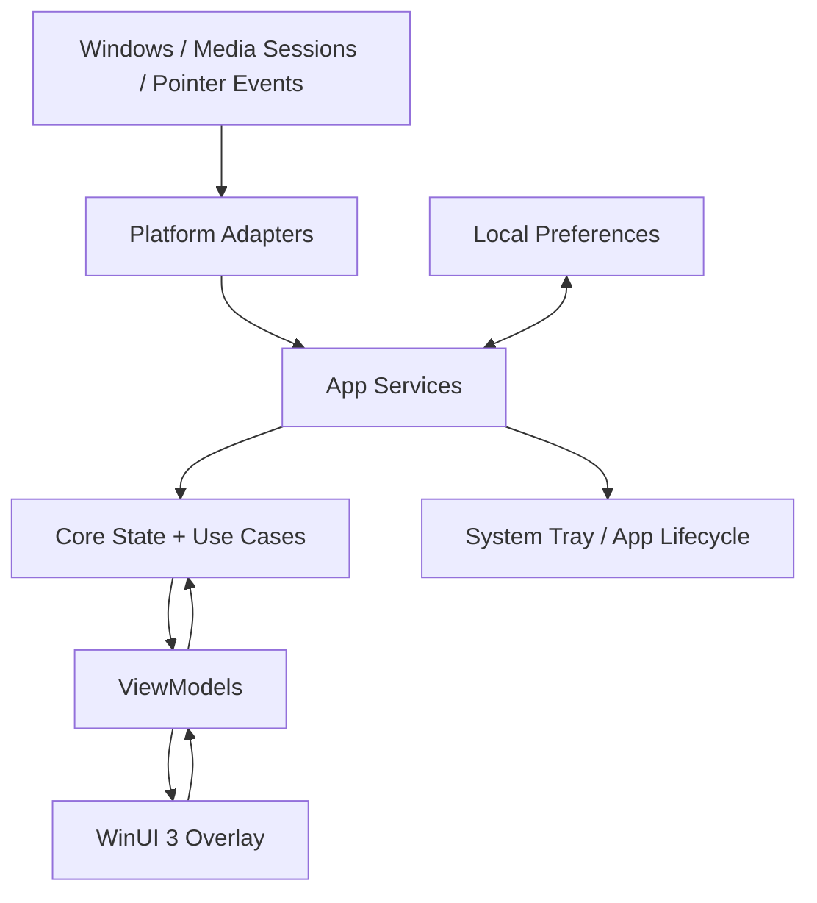
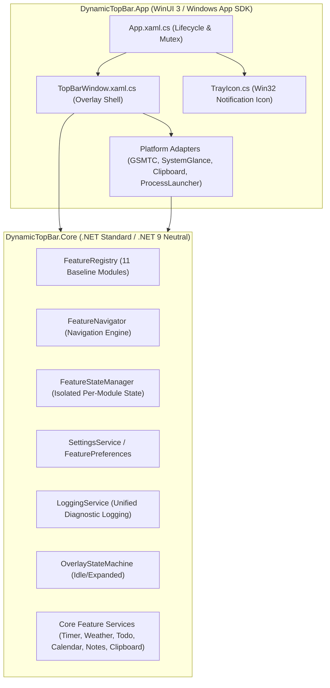
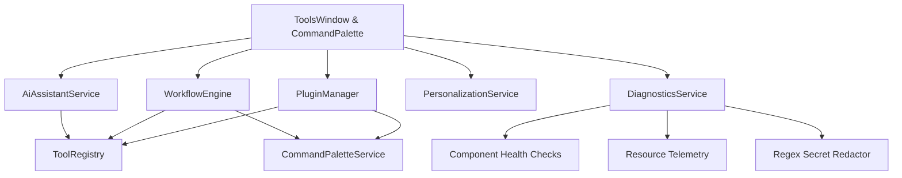

# Architecture and Component Boundaries

## 1. Architecture principle

This is a local desktop application, **not a client-server product**. “Backend” in this project means local services and OS integration inside the app process; there is no web API or remote database in the MVP.

## 2. Projects and responsibilities

### `DynamicTopBar.App`

Host and presentation layer:
- App startup and lifetime coordination.
- WinUI windows, views, resources, and view models.
- Overlay positioning, z-order, non-activation and hit testing.
- System tray integration and settings surface.
- Concrete service registration and platform adapters.

Keep WinUI types and native Windows APIs out of the Core project.

### `DynamicTopBar.Core`

Platform-independent rules:
- `OverlayState`: Idle, HoverPending, Expanded, CollapsePending.
- Neutral media model: title, artist, artwork reference, playback state, position/duration when available, supported actions.
- Transition rules and use cases.
- Interfaces/abstractions consumed by the app layer.

Core should be unit-testable without opening a real Windows window.

### `DynamicTopBar.Tests`

Automated tests for state transitions, timing decisions (using controllable abstractions where feasible), and mapping/fallback rules. UI automation is a later optional addition.

## 3. Dependency direction

Allowed: `App → Core`.

Disallowed: `Core → App`, `Core → WinUI`, and `Core → concrete Win32/WinRT classes`.

Platform-specific adapters implement interfaces and convert OS-specific values into neutral Core models. Do not add a separate process/service unless a concrete technical requirement proves it necessary.

## 4. Service and Module Boundaries

- `IFeatureRegistry`: Central catalog registering modular feature descriptors and lifecycle contracts (`IFeatureModule`).
- `IFeatureNavigator`: Coordinates multi-module switching (`Previous`, `Next`, active index, enabled filtering).
- `IFeatureStateManager`: Preserves state per module across navigation without resetting running sessions.
- `ISettingsService` & `IFeaturePreferencesService`: Thread-safe persistence of user preferences with atomic write guarantees.
- `ILoggingService`: Thread-safe diagnostics, error tracking, and diagnostic log retention in `%LocalAppData%\DynamicTopBar\logs\app.log`.
- `IFocusTimerService`: Focus timer using target end timestamp (`TargetEndTime`) as single source of truth for wall-clock consistency across sleep/resume and system time shifts.
- `IWeatherService` & `IWeatherProvider`: Open-Meteo REST provider with offline local caching and rate limiting.
- `ITodoService` & `ITodoRepository`: Local atomic JSON persistence with priority classification.
- `ICalendarService` & `ICalendarRepository`: Local schedule with iCalendar (.ics) import/export.
- `INotesService` & `INotesRepository`: Scratchpad notes with debounced autosave.
- `IClipboardService` & `IClipboardPlatformAdapter`: Strict opt-in local clipboard history manager.
- `IReminderService`: Evaluates due tasks and upcoming meetings with duplicate alert suppression.

## 5. Runtime data flow

1. Windows pointer/media event is received by an adapter.
2. Adapter converts it to a neutral event or model.
3. Core transition logic updates the overlay state or current media snapshot.
4. ViewModel exposes presentation state.
5. WinUI updates compact or expanded content.
6. User action flows back through a ViewModel/use case to the relevant service.

## 6. Failure handling

- No media session: show a neutral idle/empty state; do not invent metadata.
- Missing artwork: show a local bundled fallback icon.
- Unsupported media action: disable or omit the control rather than pretending it works.
- Media session disappears: unsubscribe safely and refresh the snapshot.
- Display geometry changes: recompute placement without crashing or leaving the overlay off-screen.
- Settings unavailable/corrupt: use defaults and preserve app startup where possible.

## 7. Technical proof of concept before commitment

Before building the full media widget, validate that the chosen Windows Media API can be called from the selected WinUI 3/.NET template and can surface session metadata and supported controls. Record API limitations and target OS assumptions. Keep this proof isolated; do not let unverified interop dictate the rest of the architecture.

## 8. Master Plan Tahap 2 — Interaction & Productivity Core Architecture

### Global Shortcut Engine
- `IShortcutService` and `ShortcutService` live in `DynamicTopBar.Core`. They manage key combinations, conflict checking, validation, import/export, and action dispatching without referencing Win32 APIs.
- `WindowsHotKeyAdapter` in `DynamicTopBar.App.Platform` bridges `IShortcutService` with native `RegisterHotKey` / `UnregisterHotKey`. Window message `WM_HOTKEY` (0x0312) is intercepted in `TrayIcon`'s subclass procedure, avoiding global low-level keyboard hooks (`SetWindowsHookEx`).
- Standard pre-configured shortcuts: Command Palette (`Ctrl+Shift+P`), Capsule visibility (`Ctrl+Shift+Space`), Panel toggle (`Ctrl+Shift+Down`), Navigation (`Ctrl+Shift+Left/Right`), Media (`Ctrl+Shift+F8`), Focus Timer (`Ctrl+Shift+F9`), and Quick Notes (`Ctrl+Shift+N`).
- Atomic JSON configuration stored at `%LocalAppData%\DynamicTopBar\shortcuts_config.json`.

### Command Palette Engine
- `ICommandPaletteService` and `CommandPaletteService` in `DynamicTopBar.Core` provide dynamic, decoupled command discovery and execution.
- Multi-factor fuzzy query scoring evaluates command title, description, category, and keywords, applying contextual score bonuses when matching the currently active module.
- `CommandPaletteContentHost` in WinUI 3 provides instant search, keyboard navigation (Up/Down/Enter/Esc), and direct command execution.

### Windows Notification Integration & Privacy
- `INotificationService` and `NotificationService` in `DynamicTopBar.Core` manage incoming alerts with FIFO burst queueing, automatic timer cycling, and 5-second duplicate suppression.
- Privacy mode (`PrivacyModeEnabled`) masks sensitive notification text into generic `"Notification from {AppSource}"`.
- `NotificationCapsulePill` displays discreet alert banners in the capsule header bar with auto-dismiss tickers and manual dismissal.

### Spotify Connect Integration
- `ISpotifyService` extends with `GetDevicesAsync` (`/v1/me/player/devices`) and `TransferPlaybackAsync` (`PUT /v1/me/player`).
- `SpotifyDevicesButton` in `SpotifyContentHost` enables swift switching between active playback hardware.

### Composite Productivity Hub
- `IProductivityHubService` and `ProductivityHubService` aggregate real-time data across `ICalendarService`, `ITodoService`, `INotesService`, and `IFocusTimerService`.
- Strictly non-redundant: zero duplicated databases or JSON files; operates reactively on top of existing services.
- `ProductivityContentHost` presents unified daily agenda, pending tasks, and focus status.

## 9. Master Plan Tahap 3 — Universal Tools Engine Architecture

### Tool Contract & Extensible Registry
- `IDesktopTool` contract in `DynamicTopBar.Core.Models` formalizes modular desktop utilities (`Id`, `DisplayName`, `Description`, `Category`, `IconGlyph`, `ParameterDefinitions`, `ExecuteAsync`).
- `IToolRegistry` and `ToolRegistry` manage thread-safe registration, category filtering, and dispatching with built-in `CancellationToken` support and structured `ToolResult` reporting.
- All tools automatically synchronize with `ICommandPaletteService`, allowing instant global discovery and execution via `Ctrl+Shift+P`.

### Image Tools Engine
- `IImageToolsService` defines compression, format conversion (JPEG, PNG, WebP), resize, crop, rotation, flip, and batch processing contracts.
- `WindowsImageToolsService` in `DynamicTopBar.App.Platform` leverages Windows Imaging Component (WIC) via `Windows.Graphics.Imaging` (`BitmapDecoder`, `BitmapEncoder`, `BitmapTransform`, `BitmapPropertySet`).
- Safety by default: never overwrites source files unless explicitly configured; generates detailed savings statistics (`SavedBytes`, `SavingsPercentage`).
- Asynchronous batch processing prevents UI thread freezing and supports real-time progress reporting.

### File Tools Engine
- `IFileToolsService` and `FileToolsService` provide:
  - Batch Rename with live simulation preview, duplicate collision detection, and safety rules (Replace, Prefix/Suffix, Numbering, Case change, Extension).
  - ZIP compression and decompression with directory structure preservation.
  - Folder Size Analyzer with infinite loop prevention (skipping symbolic links and reparse points).
  - File Search with wildcard patterns, size bounds, and date filtering.
  - Cryptographic and integrity checksum computation (MD5, SHA-1, SHA-256, SHA-512) via streaming buffers without reading entire files into RAM.
  - Folder Favorites and Recent Files tracking with atomic JSON storage (`favorite_folders.json`, `recent_files.json`).

### Advanced Clipboard Tools
- Content-type auto-detection categorizes incoming snippets into Text, URL, Code, JSON, Email, or Number.
- Sensitive data filtering detects and suppresses JWT tokens, credit card numbers, private keys, and authorization headers (`ExcludeSensitivePatterns`).
- Application blacklist (`ExcludedApplications`) ignores clipboard updates from sensitive software such as password managers.
- Auto-prune enforces customizable capacity limits (default 25) and age thresholds (default 7 days).
- Export and import capabilities for backup and migration.
- Preserves 100% strict opt-in consent: zero capture occurs without explicit user permission.

### Developer Utilities Engine
- `IDeveloperUtilitiesService` and `DeveloperUtilitiesService` provide eleven daily developer tools:
  - JSON Formatter: Indentation (prettify), minification, and syntax error diagnosis.
  - Base64: Standard and URL-safe encoding/decoding.
  - URL Encoder/Decoder.
  - UUID Generator: Configurable count, format ("D", "N", "B", "P"), and case.
  - Text Hash Calculator: MD5, SHA-1, SHA-256, SHA-384, SHA-512.
  - Text Formatter: Case transforms (Upper, Lower, Title, Camel, Snake, Kebab), line sorting, deduplication, and statistics.
  - Regex Tester: Evaluation with ReDoS timeout guard (2 seconds) and capturing groups extraction.
  - Timestamp Converter: Unix epoch seconds/milliseconds to UTC/local time and date parsing.
  - Color Picker & Converter: HEX, RGB, and HSL conversions.
  - QR Code Generator: Pure C# 2D matrix calculation, SVG output, and ASCII console preview.
  - Unit Converter: Length, Mass, Temperature, and Digital Storage conversions.

## 10. Master Plan Tahap 4 — Extensibility, Workflows, AI & Diagnostics Architecture

Tahap 4 transforms DynamicTopBar into an extensible, automated, and diagnosable desktop platform:

### 1. In-Process Plugin System
- **Contract & Isolation:** Defined by `IPlugin`, `IPluginManager`, and `PluginBase`. Plugins are registered in-process without native DLL dependencies, enforcing strict boundary isolation.
- **Manifest & Compatibility:** Plugins specify an explicit `PluginManifest` with `Id`, `Name`, `Version`, `MinAppVersion`, and `PluginPermission` flags. Plugins requiring a newer app version than the host are automatically rejected.
- **Lifecycle & Fault Isolation:** `InitializeAsync` and `ShutdownAsync` orchestrate state transitions (`Loaded` → `Active` → `Disabled` / `Failed`). Any unhandled exceptions during activation are caught by the fault isolation boundary, logging the error and marking the plugin `Failed` without crashing the host application.
- **Tool & Command Registration:** Upon activation, declared tools and palette commands are dynamically registered into `IToolRegistry` and `ICommandPaletteService`, and cleanly unregistered upon deactivation.

### 2. Multi-Step Workflow Automation
- **Sequential Execution Engine:** `IWorkflowEngine` and `WorkflowEngine` execute chains of `WorkflowStep` definitions sequentially.
- **Parameter Token Substitution:** Supports dynamic chaining where the output of a preceding step can be injected into the next step's input via `{prev.output}`.
- **Destructive Action Safety Gate:** Steps marked `IsDestructive` invoke user confirmation callbacks prior to execution; decline cancels the workflow safely.
- **Persistence & Triggers:** Saved atomically in `workflows.json` with temporary file swapping (`.tmp_GUID`). Every workflow is automatically registered into `ICommandPaletteService` with category `"Workflows"`.

### 3. Privacy-Preserving AI Assistant
- **Deterministic Local Intent Planner:** `IAiAssistantService` and `AiAssistantService` parse natural language user requests entirely in-process using local semantic keyword mapping.
- **Strict Opt-in Privacy Gate:** Disabled by default (`IsEnabled = false`). No processing occurs without explicit user opt-in in settings.
- **Permission & Destructive Protection:** Destructive intents (e.g. batch rename or file conversion) require explicit confirmation.
- **Zero Cloud Egress:** All intent resolution maps directly to local registered tools in `IToolRegistry`.

### 4. Personalization & Version Migration Engine
- **Named Profile Presets:** `IPersonalizationService` and `PersonalizationService` manage profiles including `"All-in-One Default"`, `"Deep Focus"`, and `"Media Control Studio"`.
- **Automatic Schema Migration:** Automatically detects legacy flat preferences (v1) and upgrades to versioned container (`SchemaVersion = 2`) without losing user settings.
- **Atomic Backup Export/Import:** Entire configuration can be exported as clean JSON or imported with validation.

### 5. Diagnostics, Health Monitoring & Secret Redactor
- **Subsystem Health Registry:** `IDiagnosticsService` and `DiagnosticsService` track health checks across subsystems (`MediaService`, `ToolRegistry`, `PluginManager`, `WorkflowEngine`), computing individual latency and overall system status.
- **Process Resource Telemetry:** Collects managed GC memory in megabytes, operating system thread counts, and process uptime.
- **Automated Secret Redactor:** Sanitizes exported reports and telemetry logs by stripping JWT tokens (`[REDACTED_JWT_TOKEN]`), Bearer auth tokens (`[REDACTED_BEARER_TOKEN]`), RSA private keys (`[REDACTED_PRIVATE_KEY]`), credit card numbers (`[REDACTED_CARD_NUMBER]`), and password/API key fields.

### 6. Production Release & Deployment
- Automated publish scripts (`publish.bat` and `publish.ps1`) run automated tests, clean output directories, and compile optimized x64 Release binaries to `publish/win-x64`.
- Release checklist documented in `docs/RELEASE_CHECKLIST.md`.
