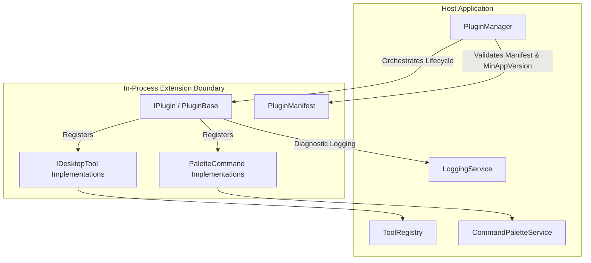
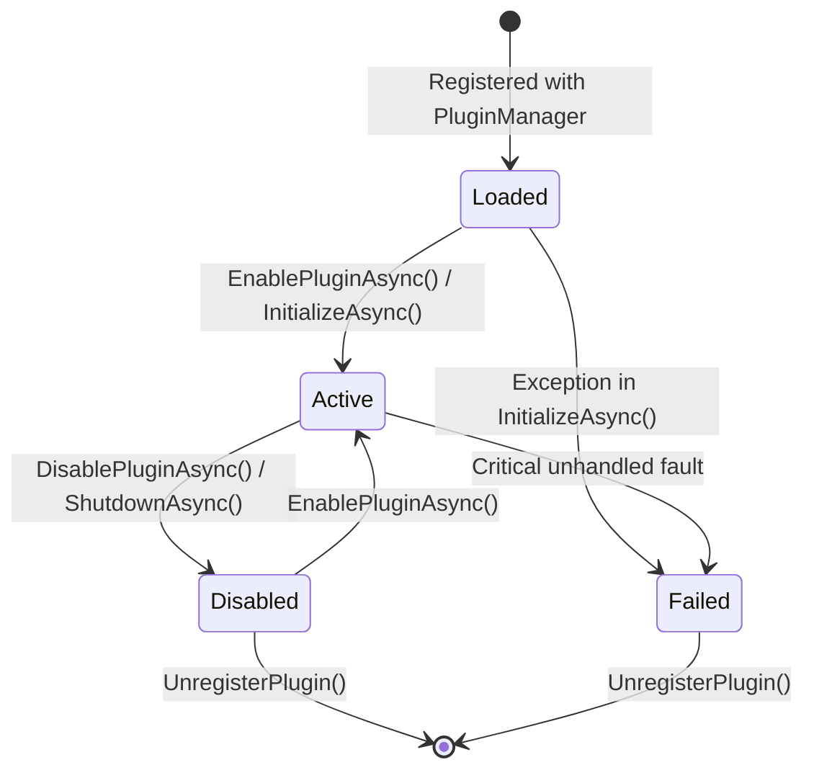

# DynamicTopBar — Plugin System Architecture & Developer Guide

## 1. Overview & Philosophy

DynamicTopBar implements an extensible, in-process modular plugin architecture that enables developers to add specialized capabilities (custom desktop tools, palette commands, and workflows) without modifying core application code.



---

## 2. Security Model & Threat Boundaries

> [!CAUTION]
> **Important Security Architecture Constraint:**
> In .NET runtime architectures, **interfaces and abstract classes do NOT provide a memory or security boundary against malicious in-process code**.
> A compiled assembly running inside the host process has access to the full address space, process token, and app memory.

### Threat Model & Mitigation Strategy

1. **Trusted vs. Untrusted Extensions:**
   - The current **in-process plugin system** is strictly designed for **trusted, first-party, and internally audited extensions** (e.g. `DeveloperToolkitPlugin`).
   - DynamicTopBar **explicitly forbids** arbitrary, automatic execution of downloaded third-party DLLs or script packages.
   - There is deliberately **no automated package marketplace** in this version to eliminate remote code execution (RCE) vectors.

2. **Fault Isolation Boundary:**
   - While in-process plugins share memory, `PluginManager` enforces a **robust fault isolation boundary**:
   - Any unhandled exception thrown during plugin initialization (`InitializeAsync`), shutdown (`ShutdownAsync`), or tool invocation is caught by the host manager.
   - The failing plugin is marked `PluginLifecycleState.Failed`, its failure reason is logged, and its registered commands are purged from `CommandPaletteService` and `ToolRegistry`.
   - **The host application and top bar overlay continue running without disruption.**

3. **Future Untrusted Extension Architecture (Roadmap):**
   - For untrusted community plugins in future releases, an **out-of-process isolation model** (worker child process running inside an isolated Windows AppContainer or Low-Integrity process, communicating via authenticated Named Pipes or local gRPC) is required.

---

## 3. Plugin Manifest Specification

Every plugin must expose an immutable `PluginManifest` record defining its identity, version requirements, and permission claims.

```csharp
public record PluginManifest
{
    public required string Id { get; init; }             // Unique reverse-DNS identifier (e.g., "plugin.dev-toolkit")
    public required string Name { get; init; }           // User-friendly display name
    public required string Version { get; init; }        // Semantic version string (e.g., "1.0.0")
    public string Description { get; init; }             // Summary of capabilities
    public string Author { get; init; }                  // Author or organization name
    public string MinAppVersion { get; init; } = "1.0.0";// Minimum DynamicTopBar version required
    public PluginPermission Permissions { get; init; }   // Declared permission flags
    public IReadOnlyList<string> Tags { get; init; }     // Search and discovery tags
}
```

### Permission Flags (`PluginPermission`)

| Flag | Value | Description |
| :--- | :--- | :--- |
| `None` | `0` | No elevated platform permissions required. |
| `FileSystem` | `1 << 0` | Plugin accesses local files or workspace directories. |
| `Clipboard` | `1 << 1` | Plugin inspects or writes to Windows clipboard. |
| `ProcessExecution` | `1 << 2` | Plugin invokes external processes (e.g. shell utilities). |
| `Network` | `1 << 3` | Plugin makes local or external HTTP requests. |
| `FullTrust` | `1 << 4` | Unrestricted internal access (reserved for built-in tools). |

---

## 4. Plugin Lifecycle & State Transitions

Plugins transition through explicit lifecycle states:



### State Definitions:
- `Loaded`: Plugin registered in memory; manifest verified against host version. Tools are not yet active.
- `Active`: Plugin successfully initialized via `InitializeAsync(context)`. Tools and commands registered in `ToolRegistry` and `CommandPaletteService`.
- `Disabled`: Plugin deactivated by user; commands and tools purged from active registries; resources disposed.
- `Failed`: Plugin encountered an unhandled exception. Isolated to protect host stability.

---

## 5. Implementing a Plugin: Step-by-Step

### Step 1: Inherit from `PluginBase`
`PluginBase` provides standardized state transitions, manifest handling, and disposal logic.

```csharp
using System.Collections.Generic;
using System.Threading.Tasks;
using DynamicTopBar.Core.Interfaces;
using DynamicTopBar.Core.Models;
using DynamicTopBar.Core.Services;

namespace MyCompany.DynamicTopBar.Plugins;

public sealed class SampleCustomPlugin : PluginBase
{
    public override PluginManifest Manifest => new()
    {
        Id = "plugin.sample-custom",
        Name = "Sample Productivity Utilities",
        Version = "1.0.0",
        Author = "Engineering Team",
        Description = "Demonstrates custom tool and palette action registration.",
        MinAppVersion = "1.0.0",
        Permissions = PluginPermission.Clipboard,
        Tags = new[] { "sample", "productivity", "custom" }
    };

    public override Task<bool> InitializeAsync(PluginContext context)
    {
        // Perform one-time setup, read plugin-specific settings:
        if (context.Settings.TryGetValue("DefaultPrefix", out var prefix))
        {
            context.Logger.LogInfo($"Configured with prefix: {prefix}", "SamplePlugin");
        }

        return base.InitializeAsync(context);
    }

    public override Task ShutdownAsync()
    {
        // Clean up unmanaged resources, file handles, or network listeners:
        return base.ShutdownAsync();
    }

    public override IEnumerable<IDesktopTool> GetTools()
    {
        yield return new CustomEchoTool();
    }

    public override IEnumerable<PaletteCommand> GetCommands()
    {
        yield return new PaletteCommand
        {
            Id = "cmd-sample-action",
            Title = "Sample Action: Run Inspection",
            Category = "Sample Plugin",
            Action = () => { /* Execute action */ }
        };
    }
}
```

---

## 6. Per-Plugin Settings Persistence

Plugins can persist isolated configuration key-values using `PluginManager.SavePluginSettingsAsync(pluginId, settings)`.
Settings are stored in:
`%LOCALAPPDATA%\DynamicTopBar\plugins\{pluginId}.settings.json`

Atomic writing (`.tmp_{GUID}` file replacement) ensures that sudden power loss or application shutdown never corrupts user configurations.

---

## 7. Reference Implementation: Developer Toolkit

DynamicTopBar includes a built-in reference plugin:
[`DeveloperToolkitPlugin`](file:///c:/Users/gresn/Documents/Kumpulan%20Project%20Seru/Multi-tools_Assisten/src/DynamicTopBar.Core/Services/Plugins/DeveloperToolkitPlugin.cs)
- Demonstrates zero-dependency modularity.
- Registers palette command: `Developer: Decode JWT Payload`.
- Registers developer helpers without modifying the WinUI host application.
