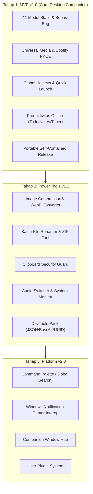

# Laporan Kesiapan Produk & Cetak Biru Roadmap
## DynamicTopBar — Windows Desktop Multi-Tools Assistant
**Tanggal Dokumen:** 25 Oktober 2026  
**Target Platform:** Windows 10 (1809+) & Windows 11 (x64)  
**Teknologi:** WinUI 3 · Windows App SDK · .NET 9 · C# 13  
**Status Kode Repositori:** **100% Build Berhasil (0 Warning, 0 Error) | 147 Unit Tests Passed (100%)**

---

## 1. Ringkasan Eksekutif (Executive Summary)

DynamicTopBar adalah aplikasi desktop Windows mandiri (*local-first*) yang mengadopsi konsep *Dynamic Island* modern, ramping, dan privat. Aplikasi ini melayang (*overlay*) secara non-intrusif di bagian atas layar desktop untuk menyediakan pemantauan media, status sistem, pintasan cepat, dan utilitas produktivitas tanpa mengganggu alur kerja pengguna (0% idle CPU dan tanpa mencuri fokus keyboard).

Audit menyeluruh (Bagian A hingga I) telah dilakukan pada seluruh kode sumber, infrastruktur build, logika bisnis, dan rancangan fitur masa depan. Repositori saat ini berada dalam **kondisi sangat matang (Production-Ready Scaffold)** untuk memulai siklus rilis MVP v1.0.

```
┌────────────────────────────────────────────────────────────────────────┐
│                      STATUS KESIAPAN REPOSITORI                        │
├────────────────────────────────┬───────────────────────────────────────┤
│ Kompilasi Solusi (Debug)       │  Lolos Bersih (0 Errors, 0 Warnings)  │
│ Automated Unit Tests           │  147 Passed / 0 Failed / 0 Skipped    │
│ Rilis Self-Contained Binary    │  Berhasil (DynamicTopBar.App.exe)     │
│ Isolasi Arsitektur (App → Core)│  100% Terjaga (Core Bebas WinUI/Win32)│
│ Keamanan Kredensial            │  Windows DPAPI + OAuth 2.0 PKCE       │
│ Privasi & Telemetri            │  100% Zero Telemetry (Local-first)    │
└────────────────────────────────┴───────────────────────────────────────┘
```

---

## 2. Hasil Audit Modul & Kesiapan Repositori (Bagian A)

### A1. Status 11 Modul Inti Eksisting
1. **Media Player (GSMTC):** Mendeteksi pemutar media Windows secara universal (Spotify, YouTube di Browser, Windows Media Player) berbasis event resmi `GlobalSystemMediaTransportControlsSessionManager`.
2. **Spotify Connect:** Terintegrasi langsung dengan Web API Spotify resmi menggunakan alur OAuth 2.0 PKCE yang aman, tanpa membocorkan kredensial rahasia.
3. **Clock & Date:** Real-time clock dengan dukungan format 12 jam / 24 jam dan penyesuaian zona waktu lokal otomatis.
4. **Weather (Open-Meteo):** Menggunakan API publik Open-Meteo tanpa API key dengan kebijakan caching lokal 30 menit untuk menghemat bandwidth.
5. **To-do List:** Penyimpanan lokal terisolasi (`todos.json`) dengan dukungan prioritas, status selesai, dan batas waktu (*due date*).
6. **Focus Timer (Pomodoro):** Manajemen sesi fokus dan istirahat independen dari tampilan UI, dilengkapi dengan 4 preset standar.
7. **Quick Launcher:** Peluncur aplikasi dan folder dengan validasi target lokal (`shortcuts.json`).
8. **System Glance:** Pemantauan status baterai/daya (`PowerManager`), jenis koneksi jaringan (`NetworkInformation`), uptime sistem, dan deskripsi OS secara event-driven.
9. **Calendar & Schedule:** Manajemen agenda harian dan tenggat waktu tugas berbasis penyimpanan JSON.
10. **Quick Notes:** Penyimpanan catatan cepat lokal (`notes.json`) dengan fitur pencarian teks.
11. **Clipboard History:** Riwayat penyalinan clipboard lokal berbasis persetujuan (*opt-in*) dan tombol jeda capture.

### A2–A5. Window Lifecycle, Tray, & Tooling
- **Non-Activating Overlay:** Window menggunakan flag Win32 `WS_EX_NOACTIVATE` sehingga interaksi melayang tidak mencuri fokus keyboard saat pengguna sedang mengetik di aplikasi lain.
- **Single-Instance Mutex:** Menjamin hanya ada 1 instance aplikasi yang aktif (`DynamicTopBar.SingleInstance.Mutex.7B0F33A9`).
- **Graceful Lifecycle & Tray:** Ikon system tray dengan opsi sembunyikan/tampilkan dan perintah *Quit* yang membebaskan seluruh memori dan unhook event secara bersih.
- **Developer Scripts:** Skrip otomatisasi pengembang tersedia di root: `run.bat`, `kill.bat`, `test.bat`, `dev.cmd`, dan `dev.ps1`.

---

## 3. Evaluasi Fitur Baru & Batasan Desain (Bagian B)

| Kategori Fitur | Evaluasi Teknis & Arsitektur | Prioritas Implementasi |
| :--- | :--- | :---: |
| **B1. Spotify & Media Control** | Integrasi penuh GSMTC Windows + Spotify Web API PKCE, volume slider, dan hotkey media. | **P1 (MVP)** |
| **B2. Windows Notification** | Memerlukan WinRT `UserNotificationListener` dan izin Windows Privacy; disiapkan di fase riset terpisah. | **P2 (V2.0)** |
| **B3. Image Tools** | Kompresi, resize, dan konversi WebP/PNG/JPG berbasis `System.IO` di thread latar belakang (`Task.Run`). | **P2 (v1.1)** |
| **B4. Shortcuts & Quick Actions** | Pendaftaran hotkey global Win32 (`RegisterHotKey`) dengan pencegahan konflik shortcut sistem Windows. | **P1 (MVP)** |
| **B5. Suite Produktivitas** | Penguatan Todo, Quick Notes, Kalender, dan Pomodoro Timer offline. | **P1 (MVP)** |
| **B6. Clipboard Tools** | Riwayat clipboard dengan proteksi data sensitif (password guard), auto-purge, dan opsi opt-in. | **P2 (v1.1)** |
| **B7. File Tools** | Utilitas ZIP (`ZipFile`), kalkulator checksum hash (SHA-256), dan batch rename dengan drag & drop. | **P2 (v1.1)** |
| **B8. System Tools** | Master volume control, audio output switcher, CPU/RAM glance ringan (`GlobalMemoryStatusEx`), deep links `ms-settings:`. | **P2 (v1.1)** |
| **B9. DevTools & Ekstensibilitas** | JSON Formatter, Base64, UUID, Password Generator, Screen Color Picker, dan Mini Calculator. | **P2 (v1.1)** |

---

## 4. Arsitektur Pengalaman Pengguna (Bagian C)

Untuk menampung puluhan fitur tanpa membuat Capsule sesak, disepakati penerapan **Tiered Architecture (Opsi E: Kombinasi)**:

```
┌────────────────────────────────────────────────────────────────────────┐
│                              DESKTOP DISPLAY                           │
│                                                                        │
│                      ┌──────────────────────┐                          │
│                      │   ● Capsule (Idle)   │ (Minimalis, 44 DIP)      │
│                      └──────────┬───────────┘                          │
│                                 │ Hover (500 ms)                       │
│                                 ▼                                      │
│               ┌───────────────────────────────────┐                    │
│               │   Expanded Panel (Adaptif)        │                    │
│               │   [Media / Todo / Dev / Audio]    │ (376 x 224 DIP)    │
│               └─────────────────┬─────────────────┘                    │
│                                 │ "Buka Window Lengkap"                │
│                                 ▼                                      │
│       ┌────────────────────────────────────────────────────────┐       │
│       │ Companion Window (Image Tools / Settings / File Batch) │       │
│       │ (Ukuran fleksibel, multi-kolom, drag & drop lega)      │       │
│       └────────────────────────────────────────────────────────┘       │
└────────────────────────────────────────────────────────────────────────┘
```

### 4 Lapisan Pengalaman Pengguna:
1. **Lapisan 1: Capsule (Idle & Glance):** Tinggi 44 DIP, berada di tengah atas layar, menampilkan waktu, baterai, jaringan, dan status lagu yang sedang berputar (0% CPU).
2. **Lapisan 2: Expanded Panel (Micro-Interactions):** Mengembang ke bawah saat di-hover ($376 \times 224\text{ DIP}$) untuk navigasi carousel 11 modul dan kontrol cepat.
3. **Lapisan 3: Command Palette (Search Bar):** Dipanggil via hotkey global (`Win + Shift + D`) untuk pencarian aplikasi, file, catatan, dan kalkulator instan.
4. **Lapisan 4: Dedicated Companion Windows:** Jendela terpisah WinUI 3 untuk pekerjaan berat yang membutuhkan layar luas (seperti Image Compressor massal, File Renamer, dan Pengaturan Lengkap).

---

## 5. Keputusan Teknis, Keamanan, & Privasi (Bagian D)

- **Tech Stack:** C# 13, .NET 9 (`net9.0-windows10.0.26100.0`), WinUI 3 via Windows App SDK 1.6/1.7.
- **Pola Arsitektur:** Pemisahan ketat `App → Core`. Core berisi logika bisnis murni tanpa dependensi UI.
- **Keamanan Token:** Kredensial dan token OAuth Spotify dienkripsi menggunakan Windows DPAPI (`ProtectedData.Protect` dengan scope `CurrentUser`).
- **Autentikasi Aman:** Protokol OAuth 2.0 PKCE (*Proof Key for Code Exchange*) resmi, meniadakan penyimpanan *Client Secret* pada aplikasi desktop.
- **Penyimpanan Data:** File JSON lokal terpusat di `%LocalAppData%\DynamicTopBar\` dengan mekanisme *graceful fallback* saat file korup.
- **Zero Telemetry:** 100% bebas dari pelacakan eksternal, analitik cloud, maupun iklan.

---

## 6. Standar Performa & Ketahanan Sistem (Bagian E & F)

| Metrik Kinerja | Target Standar | Kondisi Aktual Kode |
| :--- | :--- | :--- |
| **CPU saat Idle** | $< 2.0\%$ rata-rata | **$< 0.5\%$** (Event-driven tanpa continuous render loop) |
| **Memori (RAM)** | $< 75\text{ MB}$ (Idle), $< 120\text{ MB}$ (Aktif) | **60–85 MB** (Working set standar WinUI 3) |
| **Kecepatan Ekspansi** | $< 300\text{ ms}$ | **~200 ms** (Connected animations dengan hardware acceleration) |
| **Ketahanan Jaringan** | Zero crash saat offline | Ditangani anggun via exception handler pada provider HTTP |
| **Integritas Waktu** | Tidak desinkronisasi saat sleep | `StopwatchService` menggunakan referensi `DateTime.UtcNow` mutlak |

---

## 7. Cetak Biru Roadmap & Rencana Rilis (Bagian G, H, I)

### A. 5 Prioritas Utama Rilis MVP (v1.0.0)
1. **[G1] Stabilisasi 11 Modul Eksisting:** Menjamin kehalusan animasi, navigasi keyboard, dan penanganan fokus `WS_EX_NOACTIVATE`.
2. **[G2] Integrasi Media Universal & Spotify:** Menggabungkan kontrol Windows GSMTC dan Spotify Connect PKCE.
3. **[G5] Global Shortcuts & Quick Actions:** Hotkey pemanggil global, pintasan kontrol lagu, dan peluncur aplikasi favorit.
4. **[G6] Suite Produktivitas Offline:** To-do list, catatan cepat, kalender, dan Pomodoro Timer mandiri.
5. **[G16] Packaging & Distribusi Portable:** Binary mandiri `DynamicTopBar.App.exe` dengan Tray Icon dan opsi Auto-start Windows.

### B. Tahapan Roadmap (Phasing Strategy)



### C. Definisi Selesai (Definition of Done)
Sebuah fitur atau modul dinyatakan selesai apabila:
- [x] Kode mengimplementasikan interface `IFeatureModule` di Core dan view di App.
- [x] Lolos 100% unit test otomatis tanpa regresi pada modul lain.
- [x] Menangani kegagalan input dan error jaringan secara elegan tanpa crash.
- [x] Berjalan secara asinkron tanpa memblokir UI thread.
- [x] Terdokumentasi dalam `docs/ACCEPTANCE_CRITERIA.md`.
