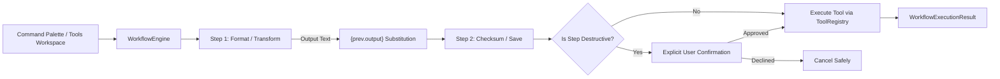

# DynamicTopBar — Workflow Automation Guide & Specification

## 1. Overview

DynamicTopBar includes a native **Sequential Workflow Automation Engine** that chains multiple desktop tools into composite, repeatable automations. Workflows can be triggered manually via the **Tools Workspace**, automatically executed via the **Command Palette**, or assigned to global hotkeys.



---

## 2. Security Architecture & Threat Protection

> [!IMPORTANT]
> **Safety Design Principle: No Arbitrary Shell Execution.**
> Many automation tools introduce critical vulnerabilities by allowing workflows to execute arbitrary shell/cmd commands. DynamicTopBar **strictly prohibits** arbitrary shell execution in workflows.
> All workflow actions must target strictly registered, schema-validated tools conforming to the `IDesktopTool` contract in `IToolRegistry`.

### Key Safety Gates:
1. **Destructive Action Confirmation Gate:**
   - Any step marked `IsDestructive = true` (such as file conversion, batch renaming, or permanent deletion) triggers an explicit user confirmation dialog.
   - If the user declines, the workflow cancels immediately without mutating data.
2. **Cancellation Token Propagation:**
   - Every step observes `CancellationToken`. When a user requests cancellation or the application shuts down, in-flight operations terminate gracefully.
3. **Error Boundary (`ContinueOnError`):**
   - By default (`ContinueOnError = false`), if any step fails, subsequent steps are aborted to prevent cascading data corruption.
   - For non-critical steps (e.g. logging an optional timestamp), `ContinueOnError = true` can be set.

---

## 3. Workflow Data Model Specification

Workflows are modeled as immutable records in `DynamicTopBar.Core.Models`:

```csharp
public record WorkflowDefinition
{
    public required string Id { get; init; }              // Unique identifier (e.g., "wf-json-checksum")
    public required string Name { get; init; }            // Display title
    public string Description { get; init; } = "";        // Purpose summary
    public string IconGlyph { get; init; } = "\uE8B7";     // Segoe Fluent Icon glyph
    public string? ShortcutHint { get; init; }            // Optional keyboard shortcut
    public List<WorkflowStep> Steps { get; init; } = new();// Ordered action sequence
    public DateTimeOffset CreatedAt { get; init; }        // Creation timestamp
}

public record WorkflowStep
{
    public string StepId { get; init; } = Guid.NewGuid().ToString("N");
    public required string ToolId { get; init; }          // ID of registered IDesktopTool
    public string Name { get; init; } = "";               // Step name
    public Dictionary<string, object?> Parameters { get; init; } = new();
    public string? InputTextTemplate { get; init; }       // Supports token substitution "{prev.output}"
    public bool IsDestructive { get; init; } = false;     // Triggers explicit confirmation
    public bool ContinueOnError { get; init; } = false;   // Abort vs continue on step failure
}
```

---

## 4. Parameter Chaining via `{prev.output}`

DynamicTopBar enables seamless output-to-input chaining between tools without writing temporary intermediate files to disk:

- When step $N$ completes successfully with non-empty `OutputText`, that text is held in memory.
- In step $N+1$, any occurrence of `{prev.output}` in `InputTextTemplate` is automatically replaced with the output of step $N$.

### Example: JSON Prettify + Checksum
```json
[
  {
    "StepId": "step-1",
    "ToolId": "tool-json-format",
    "Name": "Prettify JSON",
    "InputTextTemplate": "{\"status\":\"active\",\"code\":200}",
    "Parameters": { "mode": "Prettify" }
  },
  {
    "StepId": "step-2",
    "ToolId": "tool-hash",
    "Name": "Calculate SHA-256 Integrity Checksum",
    "InputTextTemplate": "{prev.output}",
    "Parameters": { "algorithm": "SHA256" }
  }
]
```

---

## 5. Built-in Default Workflows

DynamicTopBar ships with two preconfigured workflows in `WorkflowEngine`:

1. **Quick Focus Setup (`workflow-focus-session`):**
   - Step 1: Generates a UTC timestamp (`tool-timestamp`).
   - Step 2: Formats scratchpad banner using uppercase transforms (`tool-text-format`).
2. **JSON Validation & Checksum (`workflow-format-json-backup`):**
   - Step 1: Formats and validates input JSON string (`tool-json-format`).
   - Step 2: Computes a cryptographic SHA-256 checksum of the formatted JSON (`tool-hash`).

---

## 6. Local Atomic Storage

Workflows are persisted locally to:
`%LOCALAPPDATA%\DynamicTopBar\workflows.json`

Atomic writing (`.tmp_{GUID}` file replacement) ensures that user workflows are never corrupted during sudden power loss or process termination.

---

## 7. Command Palette Execution

All saved workflows are automatically synchronized to `ICommandPaletteService`.
To trigger any workflow:
1. Press `Ctrl+Shift+P` to open the Command Palette.
2. Type `"workflow"` or the workflow name (e.g. `"Focus"`).
3. Press `Enter` to execute. Real-time notifications report execution progress and duration.
